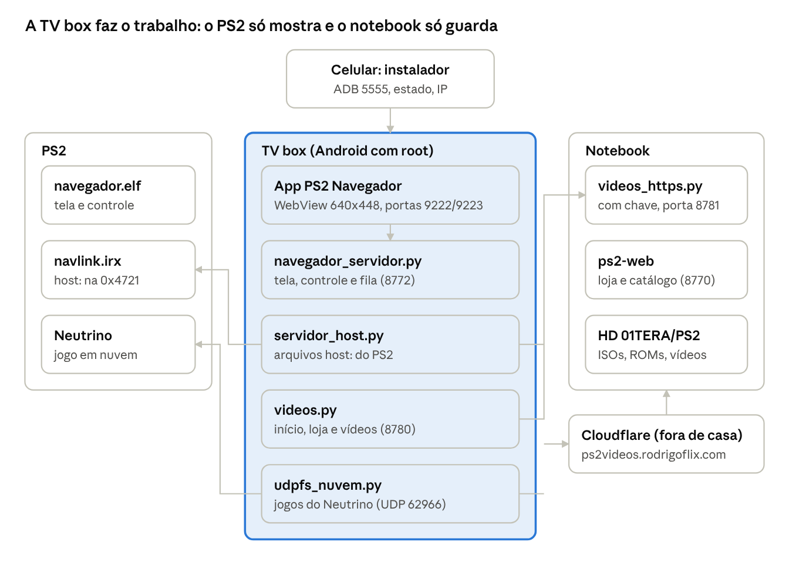
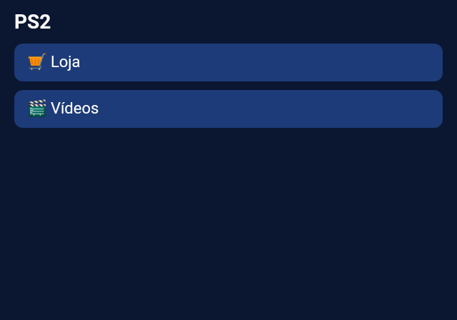
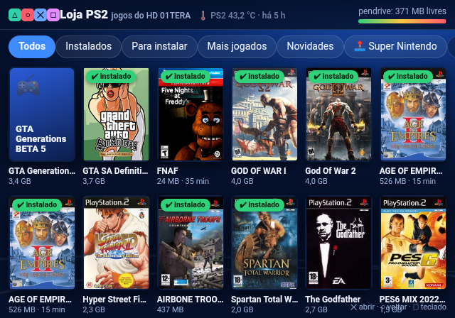
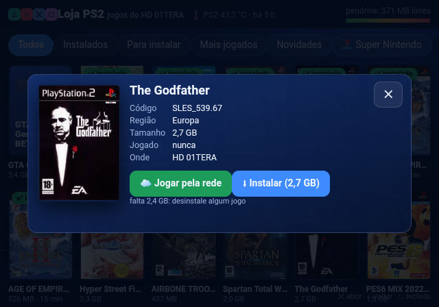
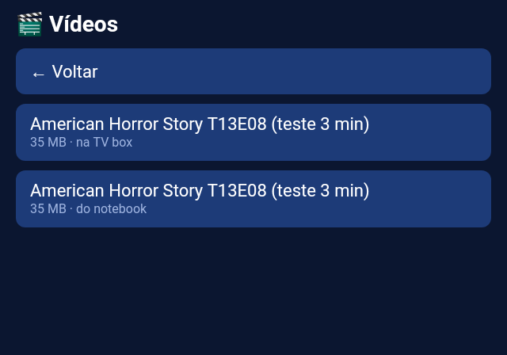

# PS2 Henbox — o "HEN" do PlayStation 2

No PS3, o **HEN** (Homebrew Enabler) é um desbloqueio que não troca peça nenhuma do console: você ativa e o PS3 passa a
rodar homebrew, lojas e backups. O **PS2 Henbox** busca chegar o mais perto possível disso no PlayStation 2, sem
modchip, usando duas peças baratas:

- **o PS2Link no PS2** — o programa que o PS2 abre (pelo OPL ou pelo memory card) e que deixa o console receber
  ordens e arquivos pela rede;
- **uma TV box Android** — que vira o "cérebro" do desbloqueio: desenha a interface, guarda e serve os jogos e
  faz o trabalho pesado que o PS2 não aguenta.

Com as duas ligadas na mesma rede, o PS2 ganha uma interface própria (o **Navegador**), com loja de jogos, jogos
direto pela rede, emuladores, vídeos e até conquistas do RetroAchievements — sem abrir o console.

> **Importante:** como o HEN, o Henbox não é um exploit de fábrica. O PS2 precisa conseguir abrir o PS2Link
> (por exemplo, com o OPL ou o FreeMcBoot no memory card). Veja os requisitos em [Instalação](docs/instalacao.md).

## Como as peças se encaixam

**PlayStation 2 (cliente magro):** não faz o trabalho pesado. Mostra a imagem que recebe e devolve os comandos do
controle, pela rede, para a TV box.

**TV box Android (o cérebro):** renderiza a interface da loja que você vê no PS2, gerencia os arquivos e serve os
jogos. Ela "desenha" a página e envia a imagem pronta para o PS2, como numa conexão remota.

**Veja o link demonstratibo de loja:** [(apenas visualização)](https://ps2videos.rodrigoflix.com/loja/?convite=DUxWDdci7OSb). São
os jogos da coleção pessoal do autor; nada é baixado nesse link demonstrativo. Jogar e baixar funcionam apenas no PS2.

## 🏆 Conquistas RetroAchievements no PS2 real

Com o app [xeRAbora](https://github.com/hacan359/xerabora) na TV box, os jogos ganham **conquistas do
RetroAchievements no PS2 de verdade** — e o Henbox prepara tudo sozinho: a TV box calcula o hash dos ISOs, busca a
lista de conquistas e manda para o pendrive do PS2, sem abrir o menu do OPL. No navegador: **⬇ Copiar para o PS2**,
**▶ Jogar** e a página **🏆 Conquistas** com o progresso e as medalhas. Testado no PS2 real com o Black (60 leituras
por segundo, 56 conquistas acompanhadas). No celular, o app [PS2 Conquistas](app-conquistas/)
([APK](downloads/PS2Conquistas.apk)) acha a TV box sozinho e avisa cada desbloqueio com a medalha e um plim de troféu.
Detalhes em [Conquistas](docs/conquistas.md).

## Telas (como aparecem no PS2, 640x448)

| Menu | Loja |
| --- | --- |
|  |  |
| **Jogo pela rede** | **Vídeos** |
|  |  |

No painel do jogo, **☁ Jogar pela rede** abre o Neutrino no PS2 lendo a ISO direto do servidor em nuvem da coleção, aos pedaços,
atraves da TV box em HTTPS.

## Instalar (sem PC)

1. Instale o app **PS2 Henbox** ([`InstaladorPS2-publico.apk`](https://github.com/RodrigoRosa95/PS2-Henbox/raw/main/downloads/InstaladorPS2-publico.apk))
   no celular → **Procurar TV boxes** → **Instalar / atualizar tudo**.
2. Espete um pendrive na TV box → **Preparar pendrive** → ponha no PS2.
3. Cabo do PS2 **direto na TV box** (ela leva o PS2 para a internet pelo Wi-Fi) → OPL → Apps → **PS2 Henbox**.

O app mostra um **🩺 estado** com ✅/❌ e o que fazer; a TV box **se atualiza sozinha** por esta pasta
[`downloads/`](downloads/); conquistas, servidor em nuvem (Linux ou **Docker**, pareado por **QR**) são opcionais.
Passo a passo e telas em [Instalação](docs/instalacao.md#telas). Também há o
[`pendrive.zip`](https://github.com/RodrigoRosa95/PS2-Henbox/raw/main/downloads/pendrive.zip) para preparar o pendrive pelo PC.

## Contato

Dúvidas, sugestões ou quer testar o PS2 Henbox na sua casa? Fale comigo:

- **WhatsApp:** [+55 51 99994-7239](https://wa.me/5551999947239)
- **E-mail:** [digorpassos16245@gmail.com](mailto:digorpassos16245@gmail.com)

Teste com os seus próprios jogos; a [loja de demonstração](#como-as-peças-se-encaixam) mostra como fica.

## Documentação

- [Instalação](docs/instalacao.md) — requisitos e o que vai no memory card, no pendrive do PS2, na TV box e no servidor
- [Fluxo técnico do sistema](docs/fluxo-tecnico.md) — peças, portas, protocolos, fluxos e problemas resolvidos
- [Conquistas RetroAchievements](docs/conquistas.md) — preparação automática, OPL-RA do Henbox e página de conquistas
- [Guia para novo usuário](docs/guia-novo-usuario.md) — uso, controles, problemas comuns e roteiro de apresentação

## Estrutura

| Pasta | O que é |
| --- | --- |
| `navegador/ps2/` | `navegador.elf` (ps2sdk + gsKit): tela, controle, vídeo MPEG-2 no IPU, cópias para o pendrive, abertura do Neutrino |
| `navegador/navlink/` | `navlink.irx`: o servidor de arquivos `host:` do PS2Link na porta TCP 0x4721 (código do ps2link, ver `LICENSE-PS2Link`) |
| `navegador/*.py` | servidores da TV box (`navegador_servidor`, `servidor_host`, `videos`, `udpfs_nuvem`, `configurar`) e do notebook (`videos_https`) |
| `navegador/tvbox/` | scripts de inicialização na TV box (Termux / Termux:Boot) |
| `navegador/tvbox-app/` | app Android da TV box: WebView numa tela virtual 640x448 + ponte DevTools |
| `navegador/instalador/` | app **PS2 Henbox** (celular ou TV box): instala tudo por ADB, Python pronto sem internet na box, estado ✅/❌, pendrive do PS2 pela USB da box, conquistas e pareamento por QR |
| `navegador/tvbox/henbox-root.sh` | root na box: PS2 direto no cabo (ponte proxy ARP ou NAT, automático) e motor das conquistas sempre ligado |
| `navegador/atualizar.py` | atualização automática da box pela pasta `downloads/` |
| `conquistas/opl-ra/` | OPL-RA do Henbox (fork AFL-3.0 do OPL do xeRAbora): patches e compilação; pronto em `downloads/OPL-RA-Henbox.ELF` |
| `servidor/` | servidor em nuvem: `instalar.sh` (Linux), `Dockerfile`/`docker-compose.yml`, `parear.py` (QR) |
| `lancador/` | `abrir.elf`: abre um ELF do memory card a partir do PS2Link |
| raiz | loja e cinema do notebook (`servidor.py`, `loja.html`, `cinema.py`…) |

## Compilar

O [GitHub Actions](.github/workflows/compilar.yml) compila o `navegador.elf` (imagem `ps2dev/ps2dev`) e os apps a cada
envio. À mão:

- PS2 (ps2sdk + gsKit em `/usr/local/ps2dev`): `make -C navegador/navlink && make -C navegador/ps2`
- App da TV box: `navegador/tvbox-app/montar.sh` (aapt, dx, android-23, apksigner — sem Gradle)
- Instalador do celular: `navegador/instalador/terceiros/baixar.sh` e `navegador/instalador/montar.sh`
  (`PUBLICO=1 navegador/instalador/montar.sh` gera o `InstaladorPS2-publico.apk`, sem chave nem endereços)
- Servidor em nuvem: `servidor/instalar.sh /pasta/da/colecao`

O pacote do instalador também precisa, fora deste repositório: `neutrino/` e `udpfs_server/` (release oficial do
[Neutrino](https://github.com/rickgaiser/neutrino)), o SNESticle e o SMS em `navegador/ps2/`, e a chave
`navegador/videos_https.chave` (criada pelo `videos_https.py` na primeira execução).

## Avisos

- Use só cópias dos seus próprios jogos. Nenhum jogo ou ROM está neste repositório; as capas nas telas são só ilustração.
- O acesso de fora de casa passa por um túnel Cloudflare protegido por chave; os termos do Cloudflare restringem
  servir vídeo pelo túnel gratuito.
- A TV box precisa de root; o instalador usa o ADB pela rede.
