# Instalação — requisitos, memory card e pendrive

O que você precisa ter e onde vai cada arquivo. O resumo: o **memory card só precisa abrir o OPL**; o **pendrive do PS2
só precisa da pasta `APPS/NAVEGADOR`**; todo o resto (Neutrino, loja, servidores) fica na TV box e no servidor em nuvem.

## Caminho rápido

Tudo pelo app **PS2 Henbox** (`InstaladorPS2-publico.apk`), sem PC:

1. **App:** instale o [`InstaladorPS2-publico.apk`](https://github.com/RodrigoRosa95/PS2-Henbox/raw/main/downloads/InstaladorPS2-publico.apk)
   no celular (ou na própria TV box).
2. **TV box:** no app, **Procurar TV boxes** → toque na sua → aceite *Permitir depuração* na TV →
   **Instalar / atualizar tudo**. (Na própria box: **Instalar NESTA TV box**.) O app baixa o Python pronto e manda
   para a box: a box não depende dos espelhos do Termux.
3. **Pendrive do PS2:** espete um pendrive na USB da **TV box** → **Preparar pendrive (na USB da TV box)** → *Copiar*
   (ou *Formatar e preparar*, que apaga tudo). A box grava o PS2 Henbox com o IP certo. Tire e ponha na USB da frente
   do PS2.
4. **Cabo:** PS2 **direto na porta de rede da TV box** (recomendado) — a box leva o PS2 para a internet pelo Wi-Fi
   dela, em qualquer casa, sem configurar nada. Ou os dois no mesmo roteador.
5. **PS2:** OPL → **Apps** → **PS2 Henbox**.
6. **🩺 Estado completo** no app mostra ✅/❌ de cada parte e o que fazer em cada ❌ (também em
   `http://IP_DA_BOX:8780/estado`).

Opcionais:

- **🏆 Conquistas:** **Instalar conquistas na TV box** (baixa o xeRAbora oficial do GitHub do autor e abre na TV;
  entre com o seu usuário do RetroAchievements e ligue *OPEN TO THE NETWORK*). **Ver conquistas e avisos neste
  aparelho** liga as notificações no celular (com a voz opcional "Você desbloqueou uma conquista no Play 2").
- **Servidor em nuvem** com a sua coleção: `servidor/instalar.sh /pasta/da/colecao` (Linux) ou Docker
  (`COLECAO=/pasta docker compose -f servidor/docker-compose.yml up -d`, Windows/Mac/Linux). Ele mostra um **QR**:
  leia com a câmera do celular e o app PS2 Henbox salva o servidor na box.

**Atualizações:** a TV box confere a pasta `downloads/` deste repositório ao ligar e uma vez por dia, se atualiza
sozinha e depois atualiza o `navegador.elf` do pendrive do PS2 na próxima conexão.

### Telas

| App PS2 Henbox | 🩺 Estado completo |
| --- | --- |
| 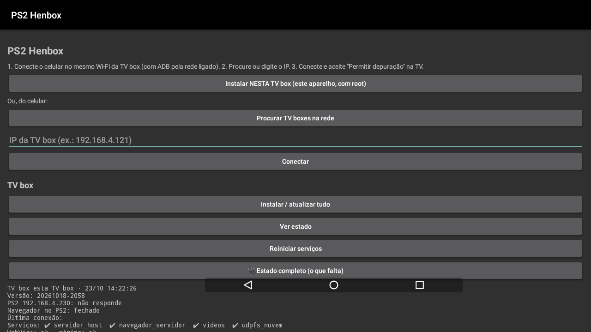 | 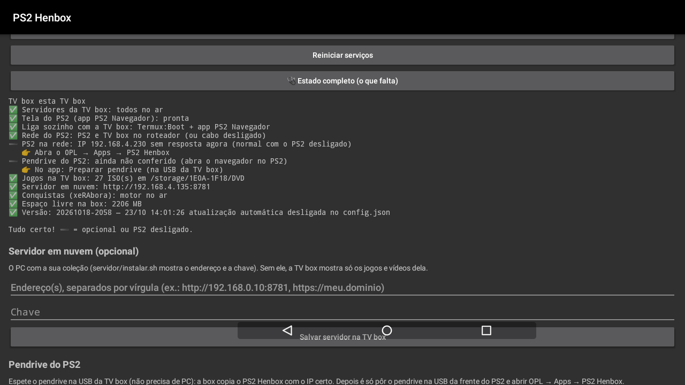 |
| **Pendrive pela TV box e conquistas** | **IP do PS2** |
| 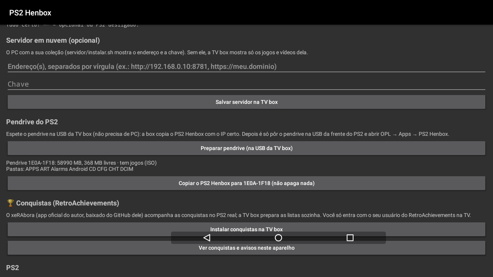 | 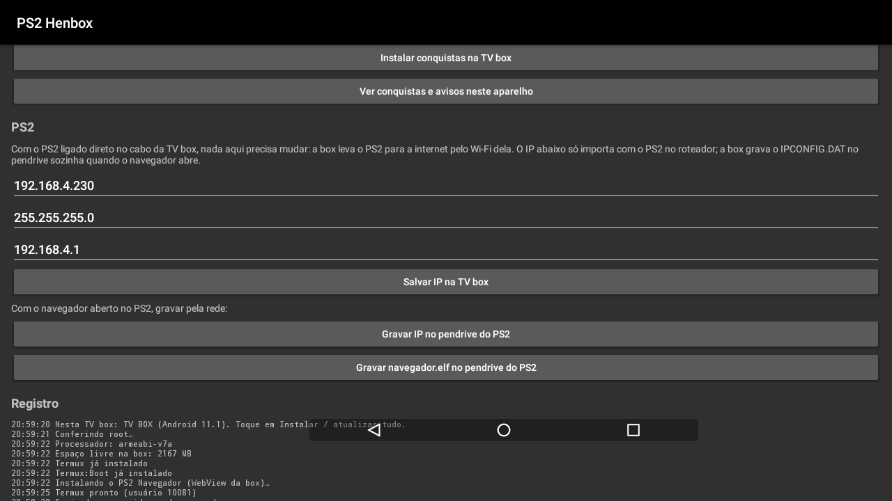 |
| **Conquistas no app** | **Voz opcional depois do plim** |
| 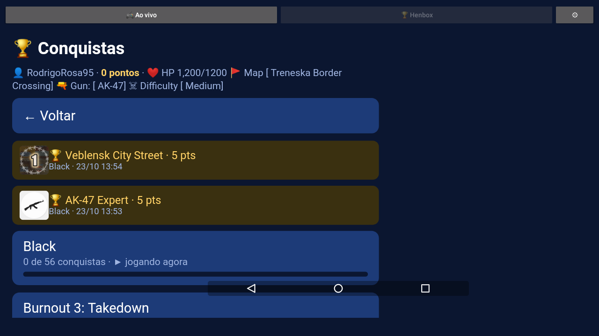 | 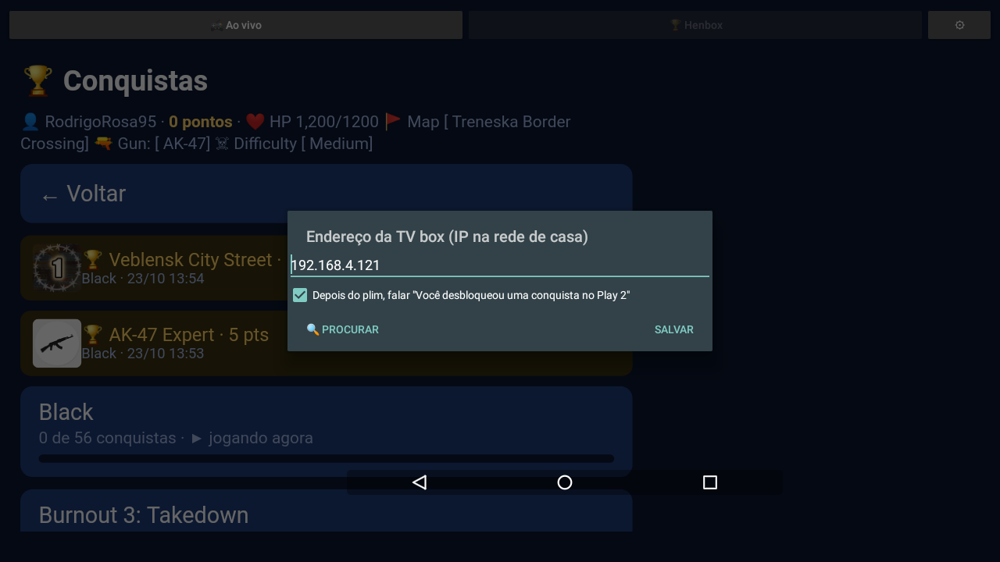 |
| **/estado na tela do PS2 (640x448)** | **Pareamento do servidor por QR** (exemplo) |
| 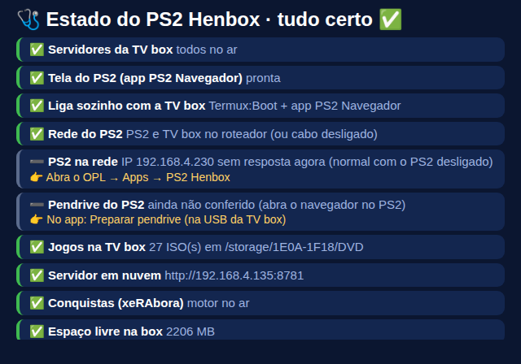 | 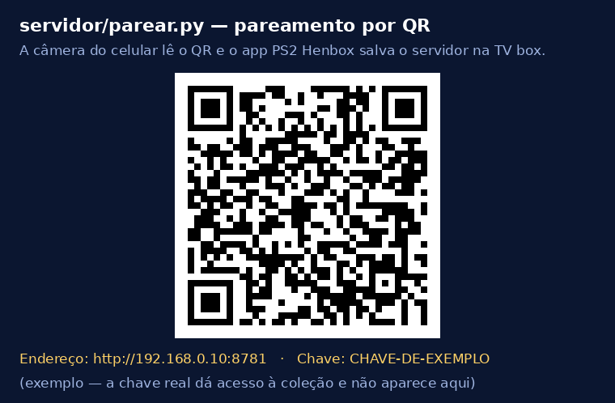 |

Troféu no tablet (Xoom Show) com o plim e a voz: 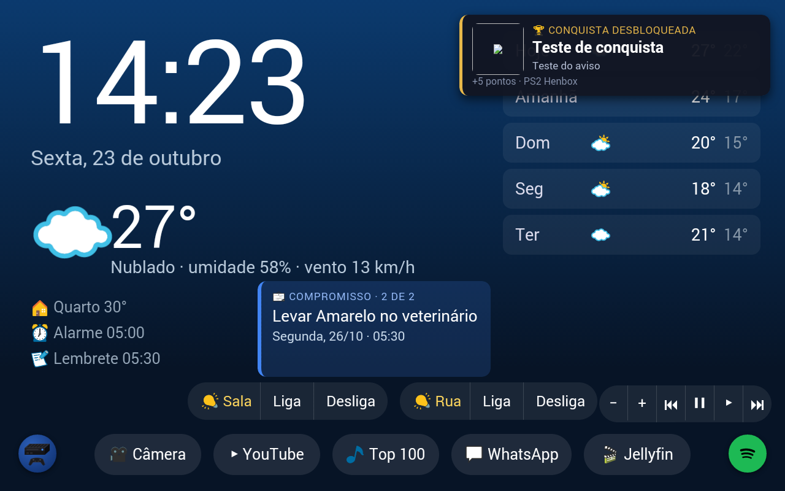

O resto desta página é o detalhe de cada passo.

## Requisitos

| Peça | O que precisa | Para quê |
| --- | --- | --- |
| PlayStation 2 | Fat com adaptador de rede (SCPH-10350) ou Slim (rede embutida) | rodar o navegador e os jogos |
| Jeito de abrir homebrew | FreeMcBoot / OpenTuna no memory card (ou modchip) | abrir o OPL |
| OPL | Open PS2 Loader 1.1.0 ou mais novo | abrir o navegador pela aba **Apps** |
| Pendrive no PS2 | FAT32, na USB da frente | guardar o `navegador.elf` (e as ROMs de SNES que a loja gravar) |
| Cabo de rede | PS2 → porta de rede da TV box, ou PS2 e TV box no mesmo roteador | o PS2 recebe a tela e os jogos pela rede |
| TV box Android | com **root**, porta de rede, ADB pela rede ligado | desenha as páginas e serve os jogos |
| Celular Android | qualquer um, na mesma rede da TV box | instalar tudo com o `InstaladorPS2.apk` |
| Servidor em nuvem | PC/notebook com Linux e a coleção (opcional) | catálogo da loja, jogos e vídeos que não estão na TV box, acesso fora de casa |
| Controle | DualShock 2; DualShock 4 por Bluetooth também funciona (adaptador USB) | navegar |

Use só cópias dos seus próprios jogos.

## Memory card

Nada deste projeto vai no memory card. Ele só precisa:

1. **Abrir o OPL** — por exemplo, FreeMcBoot com o OPL no menu (`mc0:/BOOT/` ou `mc0:/APPS/`), ou o OPL aberto pelo
   wLaunchELF.
2. **Guardar as configurações do OPL** (`mc0:/OPL/`), que o próprio OPL cria.

No OPL, em **Configurações**, deixe o **modo de início do dispositivo USB** em *Automático*, para a aba **Apps** listar
os apps do pendrive. Não é preciso configurar rede no OPL para o navegador: ele liga a rede sozinho.

## Pendrive do PS2

Formate em **FAT32** e crie esta estrutura:

```
APPS/
  NAVEGADOR_INICIAR/   ← "PS2 Henbox" no OPL: o PS2Link (NAVEGADOR_INICIAR.ELF); a TV box abre o navegador por ele
    NAVEGADOR_INICIAR.ELF  title.cfg  IPCONFIG.DAT
  NAVEGADOR/           ← "PS2 Henbox (so loja e videos)": o navegador.elf direto (sem os jogos pela rede)
    navegador.elf  title.cfg  IPCONFIG.DAT
ART/                   ← capas na aba Apps
```

O `pendrive.zip` e o **Preparar pendrive** do app gravam exatamente isso. O `title.cfg` é texto simples
(`title=PS2 Henbox` / `boot=NAVEGADOR_INICIAR.ELF`).

`IPCONFIG.DAT` (uma linha: IP, máscara e gateway do PS2, separados por espaço):

```
192.168.4.230 255.255.255.0 192.168.4.1
```

Sem o `IPCONFIG.DAT`, o PS2 usa `192.168.4.230 / 255.255.255.0 / 192.168.4.1`. A TV box mantém o `IPCONFIG.DAT`
certo sozinha: o "Preparar pendrive" grava, e a cada conexão do navegador ela confere e corrige. Com o PS2 direto no
cabo da box, o IP pode ficar o padrão em qualquer rede (veja [PS2 direto no cabo](#ps2-direto-no-cabo-da-tv-box)).

O [`pendrive.zip`](https://github.com/RodrigoRosa95/PS2-Henbox/raw/main/downloads/pendrive.zip) já traz a pasta `APPS/NAVEGADOR` pronta. O app do celular também grava o `navegador.elf` e o `IPCONFIG.DAT` no pendrive com os botões **Gravar navegador.elf no
pendrive do PS2** e **Gravar IP no pendrive do PS2** (com o navegador já aberto no PS2). Na primeira vez, copie pelo PC.

A loja cria sozinha, quando você usa o Super Nintendo:

```
SNES/                 ← ROMs gravadas pela loja
APPS/RETROARCH/       ← emulador de SNES, gravado junto com a 1ª ROM
```

**Não precisa** pôr Neutrino, ISOs nem módulos no pendrive: os jogos pela rede são lidos da TV box.

## TV box

1. Ligue o modo desenvolvedor e a **depuração ADB pela rede** (porta 5555). O app do celular mostra o passo a passo se
   não achar a box.
2. No celular, abra o `InstaladorPS2-publico.apk` → **Procurar TV boxes** → toque na sua → aceite **Permitir depuração** na TV
   (marque *Sempre permitir*) → **Instalar / atualizar tudo**.
3. Precisa de uns **400 MB livres** e de internet na 1ª vez (o Termux baixa o Python).
4. **IP do PS2 automático:** se o IP padrão não for da rede do cabo da box, o instalador escolhe um livre nela e mostra
   a linha do `IPCONFIG.DAT`. Para trocar à mão: **IP do PS2** → **Salvar IP na TV box**.
5. **Servidor em nuvem (opcional):** endereço e chave → **Salvar servidor na TV box**.

O instalador põe na box o Termux, o Termux:Boot, o app do navegador (WebView), os servidores e o
[Neutrino](https://github.com/rickgaiser/neutrino) 1.8.0 oficial (licença AFL-3.0, sem modificações).

Jogos que ficam **na própria TV box** (opcional, abrem mais rápido): um pendrive ou HD na USB da box com as pastas

```
DVD/   ← ISOs de DVD
CD/    ← ISOs de CD
```

## PS2 direto no cabo da TV box

Com o cabo do PS2 na porta de rede da box e a box no Wi-Fi, o `henbox-root.sh` (root, ligado pelo `iniciar.sh`)
percebe em ~30 s que nenhum roteador responde no cabo e liga sozinho:

- **ponte (proxy ARP)** se o IP do PS2 é da mesma faixa do Wi-Fi: o PS2 aparece na rede de casa como se estivesse no
  roteador (o Wi-Fi não aceita ponte de verdade; o proxy ARP faz o papel dela);
- **NAT** se a faixa é outra (casa de amigo): o cabo vira uma rede própria com o gateway que o PS2 espera.

Nos dois casos a box entrega o IP do PS2 por DHCP (para o OPL) e continua respondendo no IP que tinha no cabo. Ao
tirar o cabo, tudo volta ao normal. Log: `/data/local/henbox-rede/henbox-root.log`; desligar:
`echo desligado > /data/local/henbox-rede/modo` (root).

## Servidor em nuvem (opcional)

Sem ele, a TV box mostra o menu, os vídeos dela e roda os jogos do pendrive dela. Com ele, entram o catálogo da loja,
os jogos e vídeos da coleção e o acesso fora de casa.

Num PC Linux com Python 3, na pasta do repositório:

```
servidor/instalar.sh /pasta/da/colecao [IP_DA_TV_BOX]
```

Ele cria `DVD/` e `CD/` na coleção, liga os serviços (PM2, ou systemd do usuário) e mostra o
**endereço** e a **chave** para pôr no app do celular. Os ISOs vão em `DVD/` e `CD/`.

| Serviço | Arquivo | Porta | Pasta da coleção |
| --- | --- | --- | --- |
| Loja e catálogo | `servidor.py` | 8770 | — |
| ROMs, ISOs e loja para a TV box | `navegador/videos_https.py` | 8781 | `PS2/DVD`, `PS2/CD` (variável `PS2_JOGOS`) |
| Acesso fora de casa | túnel Cloudflare (`cloudflared`) | → 8781 | — |

**Fora de casa:** crie um túnel HTTPS (ex.: Cloudflare Tunnel) para a porta 8781 e use o endereço `https://…` no app.
A chave fica em `navegador/videos_https.chave`.

### Exemplo: o servidor do autor

É assim que o servidor do autor está montado. Troque o domínio e a chave pelos seus: a chave dá acesso a todos os
jogos da coleção, por isso a de verdade não vai aqui.

1. Coleção num HD do PC: `/media/rodrigo/01TERA/PS2` com `DVD/` e `CD/`.
2. No PC:

   ```
   servidor/instalar.sh /media/rodrigo/01TERA/PS2 192.168.4.121
   ```

   (`192.168.4.121` é o IP da TV box; ele mostra no fim `Endereço: http://192.168.4.135:8781` e a chave.)
3. Túnel Cloudflare para usar fora de casa, em `/etc/cloudflared/config.yml` (antes da regra final `http_status:404`):

   ```
   ingress:
     - hostname: ps2videos.seu-dominio.com
       service: http://localhost:8781
     - service: http_status:404
   ```

   e um registro DNS para o túnel: `cloudflared tunnel route dns <nome-do-tunel> ps2videos.seu-dominio.com`.
4. No app (celular ou TV box), em **Servidor em nuvem**:

   | Campo | Em casa | Fora de casa |
   | --- | --- | --- |
   | Endereço | `http://192.168.4.135:8781` | `https://ps2videos.seu-dominio.com` |
   | Chave | a do `videos_https.chave` | a mesma |

   No campo **Endereço**, ponha os dois separados por vírgula
   (`http://192.168.4.135:8781, https://ps2videos.seu-dominio.com`) e toque em **Salvar servidor na TV box**: a box
   tenta o de casa primeiro e, se não alcançar, o HTTPS.

   | Servidor preenchido (a chave aparece só como pontos) | Registro da instalação na TV box |
   | --- | --- |
   | 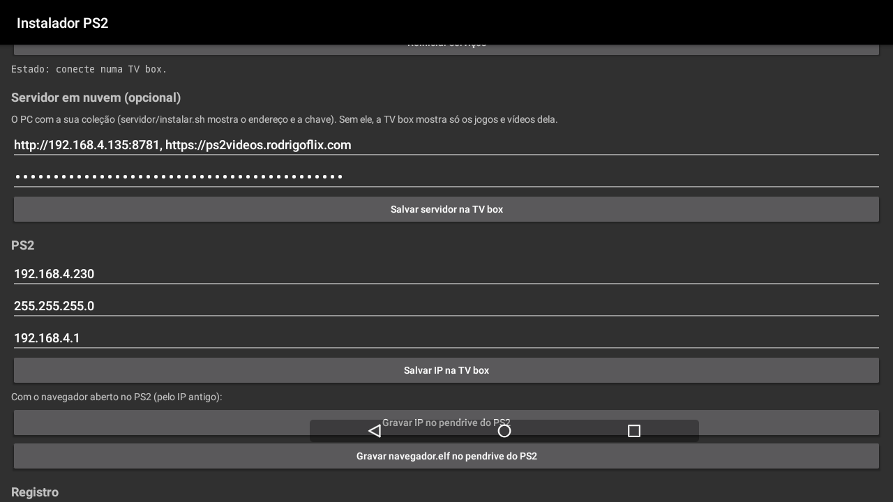 | 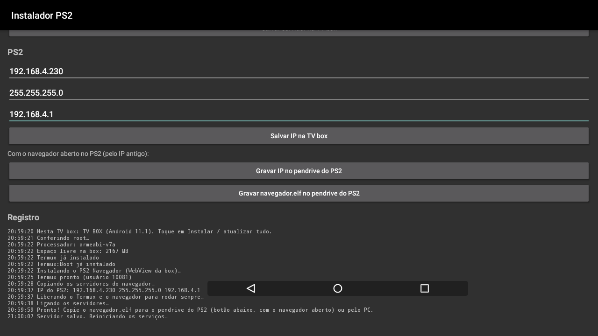 |

   Sem tocar na tela (pelo ADB, ou numa TV sem toque):
   `am start -n br.ps2nav.instalador/.Principal --es servidor "http://…:8781, https://…" --es chave CHAVE --es acao instalar-aqui`
   (o registro também fica em `/data/data/br.ps2nav.instalador/files/registro.txt`).

No app, com os dois endereços e a chave (a chave aparece como pontos):


E o registro de uma instalação completa feita direto na TV box, já salvando o servidor:


Comandos sem tocar na tela (ADB), úteis numa TV sem mouse:

```
adb shell am start -n br.ps2nav.instalador/.Principal --es acao instalar-aqui \
    --es servidor "http://192.168.0.10:8781, https://ps2videos.seu-dominio.com" --es chave SUA_CHAVE
```

(`acao`: `instalar-aqui` instala tudo nesta box; `servidor-aqui` só salva o servidor; `conectar-aqui` só mostra o estado.)

Para ver como a loja fica com uma coleção de verdade, abra a
[vitrine da loja do autor](https://ps2videos.rodrigoflix.com/loja/?convite=DUxWDdci7OSb) (só para olhar).

## Primeiro uso

1. TV box ligada há 1 minuto.
2. PS2: OPL → **Apps** → **PS2 Henbox**.
3. A barra azul pulsa enquanto a TV box conecta; em poucos segundos aparece o menu **Loja / Vídeos**.

Se a barra não sair: confira o cabo, se o IP do `IPCONFIG.DAT` é o mesmo salvo na TV box, e o **Ver estado** no app do
celular.
