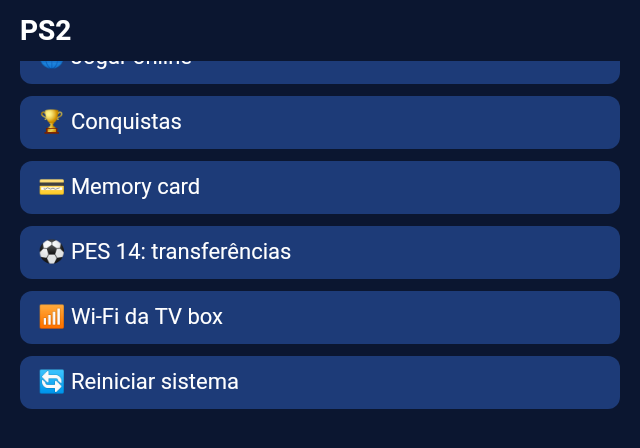
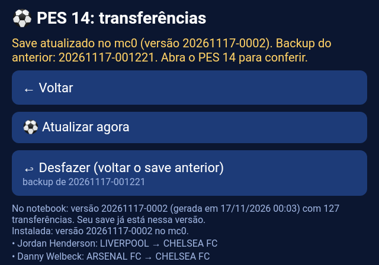
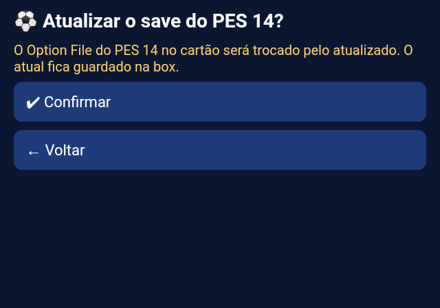
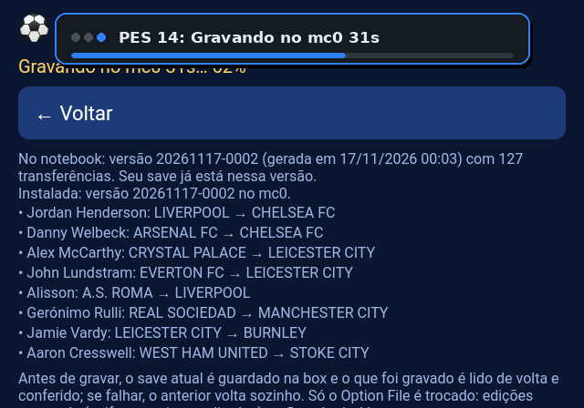
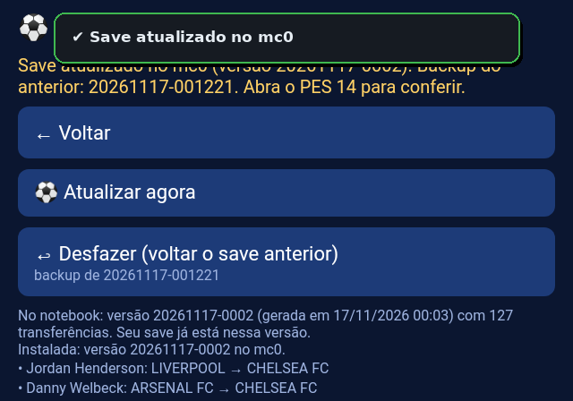

# ⚽ PES 14: transferências atualizadas (subprojeto do PS2 Henbox)

Um botão no `navegador.elf` do [PS2 Henbox](../README.md) que **baixa o Option File do PES 2014 (PS2) já com as
transferências atuais e grava no memory card**, com backup antes, conferência depois e botão de desfazer. O notebook
gera o save sozinho toda semana; a TV box só baixa e grava.

> Testado no PS2 real em 17/11/2026: o botão baixou, gravou e os jogadores apareceram nos clubes novos.

## Como funciona

```
 NOTEBOOK (toda semana)                           TV BOX                         PS2
 ┌──────────────────────────────┐   HTTP     ┌────────────────┐   host:     ┌──────────────┐
 │ Transfermarkt → elencos      │ ─────────▶ │ pes14.py       │ ──────────▶ │ navegador.elf│
 │ casa nomes com o jogo        │ manifest + │  1. baixa+sha  │  op 0/6/8   │  lê/grava no │
 │ edita o Option File (cifrado)│ Option File│  2. backup     │             │  memory card │
 │ publica em /pes14/           │            │  3. grava+lê   │ ◀────────── │  (mc0 / mc1) │
 └──────────────────────────────┘            │  4. desfaz se  │  faixa com  └──────────────┘
                                             │     falhar     │  progresso
                                             └────────────────┘
```

No PS2: abra o `navegador.elf` → **⚽ PES 14: transferências** → **Atualizar agora**. A faixa no alto da tela mostra a
etapa, os segundos e uma barra de progresso. Se o memory card estiver em uso, a atualização espera a vez.

### O que o botão garante
1. **Nada é gravado sem backup.** O Option File atual é copiado para a box (`ps2/pes14/backup/<data>/`, ficam os 5
   últimos) e cada cópia tem o tamanho conferido.
2. **O download é conferido** (`sha256` do manifesto) antes de tocar no cartão.
3. **Só o Option File é regravado** (os arquivos de ícone do save não mudam). Depois de gravar, o arquivo é **lido de
   volta** e comparado.
4. **Se a conferência falhar, o save anterior volta sozinho** e também é conferido. Há ainda **↩ Desfazer** na página.
5. Sem save no cartão (o PES 14 precisa ter criado o Option File uma vez), o botão **não grava nada**.

## Telas (como aparecem no PS2, 640×448)

| Menu inicial | Página do PES 14 |
| --- | --- |
|  |  |
| **Confirmação** | **Em andamento** (etapa, segundos e barra) |
|  |  |
| **Concluído** | |
|  | |

As telas 1 a 3 são quadros reais enviados ao PS2 pela TV box (a página mostra o resultado de uma atualização de verdade: versão
instalada, backup guardado, botão de desfazer). Nas telas 4 e 5 a **faixa no alto é desenhada pelo mesmo código que a desenha no PS2**
(`desenhar_aviso`, do `navegador_servidor.py`) sobre quadros reais; o estado "em andamento" foi forçado só para a captura, sem gravar nada no cartão.

## O que ele atualiza (e o que não)

- Move **jogadores que já existem no jogo** entre os 130 times (clubes das ligas inglesa, brasileira, italiana, alemã,
  espanhola, francesa e outras). Quem chega entra no fim do elenco, sem número fixo; quem sai libera a vaga.
- **Não cria jogadores nem rostos novos.** O jogo é de 2014/15 e o save base tem extras de patch: só ~5% dos jogadores dos
  elencos atuais existem nele (no teste: 147 casados, 127 transferências aplicadas, 8 recusadas por elenco cheio).
- As seleções nacionais não são alteradas. Cada elenco tem no máximo 32 vagas.
- Aplica as transferências sobre o **Option File base** que você copiou uma vez: edições feitas depois no seu Option File
  (uniformes, times editados) são substituídas na atualização.

## Instalação

### 1. Notebook (gera e publica)

Requisitos: Python 3.9+ (só biblioteca padrão) e `curl`. Estrutura de trabalho (relativa a `notebook/`, ou a `PES14_DIR`):

```bash
cd pes14/notebook
mkdir -p original/BESLES-556762014OPT
# copie do SEU memory card o Option File e os 2 ícones para original/BESLES-556762014OPT/
#   (pelo PS2Link, uLaunchELF, pela Central da TV box ou por um backup do cartão)

git clone https://github.com/PeterC10/PESEditor ref/PESEditor     # só a tabela de chave da cifra (veja docs/FORMATO.md)
python3 preparar_base.py        # decifra, confere checksums e prova o round-trip idêntico
python3 atualizar_tudo.py       # raspa os elencos, casa os nomes, gera e publica (~7 min na 1ª vez)
```

`atualizar_tudo.py` **não publica nada** se o Transfermarkt vier incompleto (menos de 100 clubes), se casarem poucos
jogadores (menos de 100) ou se menos de 50 transferências couberem. Para rodar toda semana (domingo, 04:40):

```cron
40 4 * * 0 flock -n /tmp/pes14.lock python3 /caminho/pes14/notebook/atualizar_tudo.py >> /caminho/pes14/notebook/atualizar-cron.log 2>&1
```

Sirva a pasta publicada (`PES14_PUBLICAR`, padrão `notebook/publicado/`) em `/pes14/` por um servidor HTTP da sua rede.

### 2. TV box (baixa e grava)

Copie [`box/pes14.py`](box/pes14.py) e siga [`box/INTEGRACAO.md`](box/INTEGRACAO.md): são três trechos no
`navegador_servidor.py`, a página/rotas no `videos.py` e um botão na tela inicial.

## Estrutura

| Pasta | Conteúdo |
|---|---|
| `notebook/` | `pes14fmt.py` (cifra, checksums e mapa do Option File), `raspar.py`/`parse2.py` (Transfermarkt), `casar*.py` (nomes), `gerar.py` (edita o save), `publicar.py`, `atualizar_tudo.py`, `tm/mapa_clubes.json` (clubes do jogo ↔ Transfermarkt) |
| `box/` | `pes14.py` (o módulo da TV box) e `INTEGRACAO.md` |
| `tests/` | `test_pes14.py`: 7 cenários com um PS2 simulado (veja [docs/TESTES.md](docs/TESTES.md)) |
| `docs/` | [FORMATO.md](docs/FORMATO.md): o Option File do PES 2014 PS2 decifrado |

## Como os jogadores são casados

Nome do Transfermarkt ↔ nome no jogo (abreviado: `D. RICE`, `MBAPPE`, só o apelido…), exigindo **altura a menos de 2 cm**
e **ano de nascimento compatível** com a base do save. Casar só pelo sobrenome só vale se ele é raro no jogo; primeiro
nome sozinho nunca casa. Em dúvida, o jogador **não** é movido: é preferível deixar de mover a mover o jogador errado.

## Aviso legal

- Este projeto **não contém nenhum dado do jogo**: nem Option File, nem a tabela de chave da cifra (vem do
  [PESEditor](https://github.com/PeterC10/PESEditor), que você baixa), nem os dados raspados. Você usa o **seu** save.
- Os elencos vêm do [Transfermarkt](https://www.transfermarkt.com), para **uso pessoal**, com pausa de 3 s entre páginas e
  uma rodada por semana. Respeite os termos do site; os dados continuam sendo dele.
- Projeto de fãs, sem vínculo com Konami, Sony ou Transfermarkt. *Pro Evolution Soccer* é marca de seus donos.
- Use por sua conta: o botão tem backup e conferência, mas faça também um backup do cartão antes da primeira vez.

## Créditos

Formato do Option File: o trabalho de **Compulsion** (PESFan Editor), **Juce** e **PeterC10** ([PESEditor](https://github.com/PeterC10/PESEditor));
testes em memory card virtual com [mymcplus](https://pypi.org/project/mymcplus/) e [PCSX2](https://pcsx2.net).
